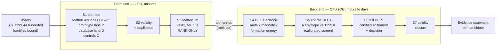
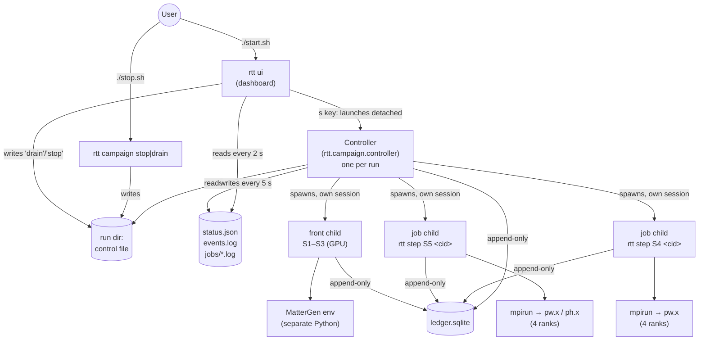
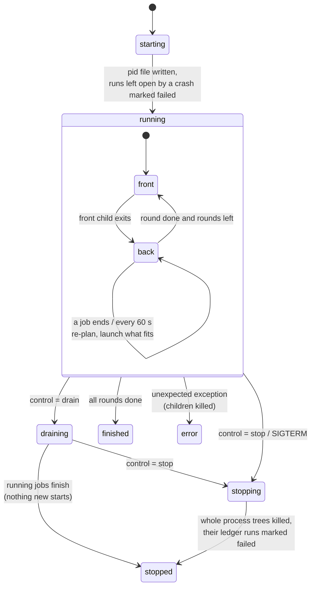
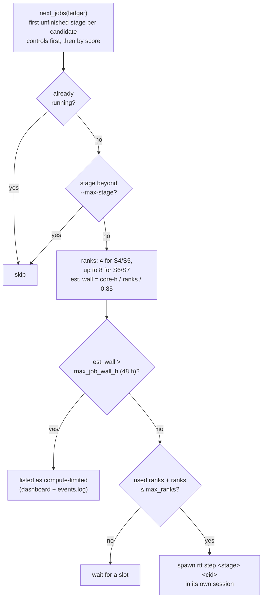
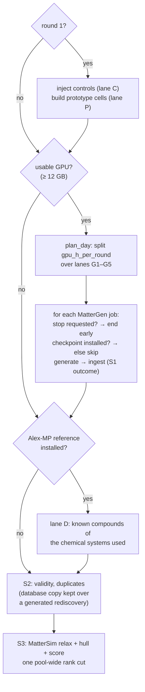
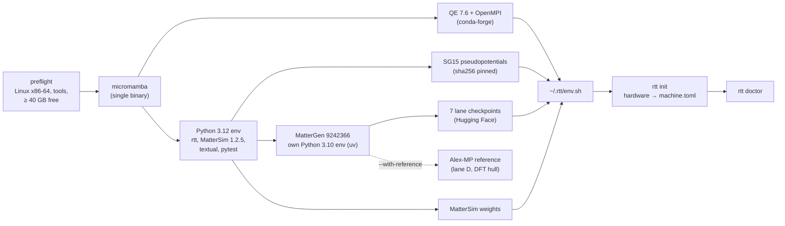

# How the system works: logic, flow and design reasons

This document explains what `install.sh`, `start.sh`, `stop.sh` and the `rtt` commands do, how
the pieces fit together, and why they were built this way. Setup steps are in
[INSTALL.md](INSTALL.md); the physics behind each stage is in `docs/theory/` and `docs/design/`.
GitHub renders the diagrams below. In a plain editor, read them as lists of boxes and arrows.

---

## 1. What the pipeline is trying to do

The goal is a conventional (electron–phonon) superconductor with Tc ≥ 300 K at about 1 atm.
The system works backwards from that goal.

1. **Theory sets a hard target first.** In isotropic Migdal–Eliashberg theory,
   k_B·Tc ≤ A / 4.33148145 for every spectrum, where A = ∫α²F(ω) dω (docs/theory/01, certified
   with interval arithmetic and Lean). Tc ≥ 300 K therefore **requires A ≥ 1299.44 K**. A
   material whose A is provably below that cannot reach 300 K, whatever its other properties.
2. **Cheap stages try to rule candidates out, expensive stages try to prove things.**
   Generating a structure costs seconds, a DFT check minutes, a coarse phonon calculation hours
   to a day, a full one days. Each stage only spends compute on what the cheaper stages could
   not rule out.
3. **Only calibrated physics removes candidates. Machine learning only reorders them.** An ML
   model (MatterGen, MatterSim) can be wrong in ways nobody can bound. Doc 15 is the example:
   MatterSim called Mg₂IrH₆ unstable, but DFPT showed it stable. So ML scores decide the *order*
   of work, and an ML-only reason can only *defer* a candidate, never reject it. Removals come
   from DFT/DFPT rules whose error margins were measured (doc 13, doc 16).

Each stage writes one **outcome** per candidate into the ledger:

| Outcome | Meaning | Who may issue it |
|---|---|---|
| `PASS` | go on to the next stage | any stage |
| `DEFERRED(reason)` | not now (rank cut, not calibrated for this case, compute limit); may be retried | any stage, including ML |
| `SCREENED_OUT` | removed by a calibrated rule with a measured safety margin | S1/S2 rules, S4, S5 only |
| `rejectedProven` / `pass` / `undecided` | the certified decision | S6/S7 only |
| `ERROR` | something failed; retried with back-off | any stage |

---

## 2. The pieces and how they talk

**Why the dashboard and the controller are separate processes.** A campaign runs for days.
If the dashboard *were* the campaign, closing the terminal, losing an SSH connection or a UI crash
would kill a week of compute. The controller is detached (its own session, no terminal). The
dashboard only reads `status.json` and the logs, and only writes the one-word `control` file. You
can close and reopen it, or open it from another terminal, without touching the running work.
`rtt campaign status` and `./stop.sh` do the same without a UI.

**Why a control file instead of signals or a socket.** The controller only has to check a file
every few seconds. It works across terminals, survives a dashboard restart, and needs no open
port. It also leaves an inspectable trace (`cat control`). SIGTERM/SIGINT to the controller still
work and mean "stop".

**Why each job is a separate child process.** QE stages run for hours. A crash, a hung MPI rank
or a memory error inside one job must not take down the controller or the other jobs. A child
`rtt step <stage> <cid>` is also exactly what a person would run by hand, so a campaign can be
reproduced one step at a time.

**Why the ledger is append-only SQLite.** Every decision, with its inputs, thresholds, config
hashes and tool versions, is a row that triggers forbid editing or deleting (`ledger/schema.sql`).
This is the audit trail: an outside reviewer can check why each candidate was removed. SQLite in
WAL mode lets the controller and several job processes write safely at once without a database
server. It lives on the Linux file system (`~/.rtt/runs/...`) because SQLite locking is unreliable
on Windows drives mounted into WSL.

---

## 3. The controller's logic

A **round** is one front-end pass followed by back-end work until nothing more can start.
`--rounds N` runs N rounds; `--rounds 0` repeats until stopped.

Back-end scheduling, every time a job ends and at least once a minute:

Why it is built this way:

- **Rank budget, not job count.** QE jobs differ in size (4 vs 8 MPI ranks). Counting ranks
  against `max_ranks` (physical cores − 1) keeps the machine fully used without oversubscribing
  it. Oversubscription made QE runs slower and once crashed the WSL VM on the reference machine.
- **One core kept free.** The controller, dashboard, SQLite and the OS need some CPU. Without it
  the dashboard stalls exactly when you want to stop something.
- **Fixed 4 ranks per S4/S5 job.** Every measured cost and the S5 calibration (docs 13, 16, 31)
  used this setting. A bigger machine runs more candidates at once instead of the same candidate
  on more ranks. Throughput scales, and the measured numbers stay valid.
- **Compute-limited jobs are reported, not run.** A full DFPT on a 9-atom hydride can need over a
  week on 8 cores. Starting it would block the machine for days with no early result. The cap
  (48 h by default, `max_job_wall_h` in `machine.toml`) turns that into an explicit
  "needs more compute" entry.
- **Controls go first.** Known materials (Al, Pb, Nb, Mg₂IrH₆, H3S, MgB₂) check that each stage
  still gives known answers on this machine before any new candidate is trusted (doc 12).
- **Stop kills whole process trees.** QE's launcher starts `mpirun` in a new session, so killing
  only the job's process group would leave the MPI ranks running. The stop test on the reference
  machine showed exactly this before the fix. Stop therefore collects every descendant of every
  job first, signals all their process groups (SIGTERM, SIGKILL after 30 s), then kills any
  process still running inside the run's `work/` folder.
- **An interrupted job is never a result.** Its open ledger run is marked `failed`, so the
  scheduler simply retries it on the next start. Partial QE output is never decided on.
- **Drain vs stop.** Draining lets hours-long jobs finish so their compute is not wasted. Stop is
  for when the machine is needed now.

---

## 4. One front-end round

Why:

- **Several lanes, not one.** No single source is trustworthy. MatterGen's property conditioning
  plateaus outside its training data (doc 14). Its composition conditioning works, but much of
  its "novel" output rediscovers known compounds (R30). The prototype lane P covers the one
  family that comes close to the target (Mg₂IrH₆-type, doc 32), and lane D supplies known
  compounds as a baseline. Every candidate records its lane, so the lanes can be compared
  stage by stage.
- **GPU hours per round, not structure counts.** Generation cost differs by checkpoint. A fixed
  GPU budget keeps rounds predictable and leaves the GPU free between rounds.
- **The rank cut is pool-wide.** Ranking chunk by chunk would let the first chunk take all the
  slots (bug B9, doc 31). One cut over the whole round, written into the `rank_pools` table, is
  deterministic.
- **Nothing is downloaded during a campaign** (`HF_HUB_OFFLINE=1`). All downloads happen in
  `install.sh`, where they are hashed and recorded. A campaign is then reproducible from the
  install manifest.

---

## 5. The install

Why:

- **Everything under `~/.rtt`, no root, no system packages.** Anyone with a Linux account can
  install it, nothing on the machine is changed, and `rm -rf ~/.rtt` removes it completely.
- **micromamba + conda-forge for QE.** It is the one way to get the same QE build (7.6, OpenMPI)
  on any Linux without compiling Fortran and MPI by hand.
- **MatterGen in its own environment.** MatterGen pins old versions (Python 3.10, torch 2.2)
  that conflict with MatterSim and the rest. rtt calls it as a subprocess
  (`source/external.py`), so the two never share a Python. Its environment is built with `uv`
  because MatterGen's `pyproject` carries uv-only settings for the `torch_cluster` wheels; plain
  pip fails (found during the install test).
- **Pinned versions and recorded hashes.** Every measured cost, calibration constant and
  threshold in `docs/design` was produced with these exact versions (`tools/versions.env`).
  `install_manifest.txt` records the sha256 of every download, so two machines can show they
  run the same thing. The SG15 pin was checked byte-for-byte against the reference machine.
- **`rtt init` sizes the machine, `rtt doctor` checks it.** Hard-coding the reference machine's
  core count would underuse bigger machines and overload smaller ones. Optional pieces (GPU,
  reference set) switch lanes off instead of failing the install.

---

## 6. Files at a glance

| File | Role |
|---|---|
| `install.sh` | one-time setup into `~/.rtt` (§5) |
| `start.sh` | runs `rtt doctor`, then opens the dashboard |
| `stop.sh` | `rtt campaign stop` (or `--drain`) without the dashboard |
| `tools/versions.env` | every pinned version and hash |
| `src/rtt/campaign/hw.py` | hardware detection, sizing rules, `machine.toml` text |
| `src/rtt/campaign/controller.py` | the controller (§3) |
| `src/rtt/campaign/front.py` | one front-end round (§4) |
| `src/rtt/campaign/ui.py` | the dashboard (reads status files, writes `control`) |
| `src/rtt/campaign/doctor.py` | installation checks |
| `src/rtt/campaign/home.py` | `~/.rtt` layout, pid/status helpers |
| `src/rtt/engine/` | stages S1–S7, scheduler, retry rules (unchanged by the runner) |
| `tests/test_campaign_runner.py` | sizing, controller start/drain/stop (including MPI-style grandchildren), dashboard |

## 7. Verified on the reference machine (2026-11-01)

- `install.sh` from scratch: completes, and `rtt doctor` reports ready, with QE 7.6, 219 SG15
  files, 7/7 checkpoints and CUDA. Only the optional reference set is off.
- MatterGen from the new environment: generated 4 Mg–Ir–H structures.
- `rtt campaign start --smoke`: Al control PASS at S1–S5 in 7 minutes, end to end through the
  controller.
- Stop during a running S5: all 4 `ph.x` ranks and `mpirun` gone within about 2 s, open ledger
  runs marked failed.
- Test suite in the fresh environment: all pass.
